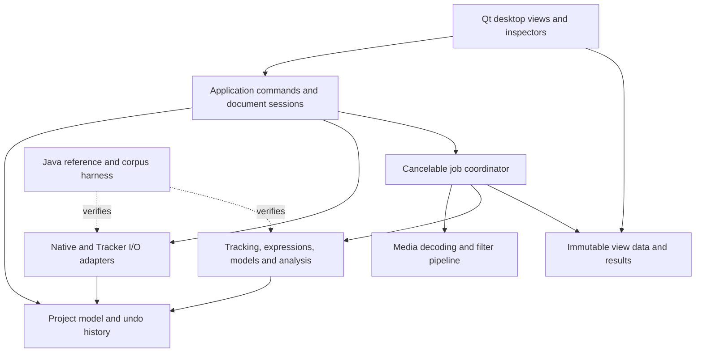

# MoTrack full-port plan

This is the canonical scope, requirements, architecture, status, and execution order for completing
the native desktop port. Update it with implementation evidence as work lands. It is not a claim that
the port is complete. Contributor commands live in [CONTRIBUTING.md](../CONTRIBUTING.md), agent workflow
in [AGENTS.md](../AGENTS.md), and per-change checks in [code-review.md](code-review.md).
The [Tracker issue audit and triage](upstream-issues.md) maps upstream reports to native issues,
regression requirements and accepted/deferred feature decisions. Consult it as each slice is ported.

## Goal and completion contract

Deliver Tracker's desktop video-analysis and modeling workflows in a C++23 application on Windows,
macOS, and Linux. Users must be able to open existing experiments, perform the corresponding edits and
analysis, save standard Tracker files, and continue in Tracker. A `.motrack` companion alongside the
standard files is acceptable; it cannot substitute for a usable `.trk` or `.trz` output.

The scope baseline is **Tracker desktop 6.3.5**, listed in the official
[change log](https://opensourcephysics.github.io/tracker-website/change_log.html) as released on
2026-06-22. Include its filtered point-mass clones and per-tab/default units. Cover representative older
files through the corpus; do not promise every historical codec or file variant without tests.
Pin the actual reference executable, dependencies, and matching source in phase 1 before declaring
behavior equivalent. The source inventory reviewed for this plan is upstream
[020692a3d23781763dd8a7a19d73bf004c3faefe](https://github.com/OpenSourcePhysics/tracker/tree/020692a3d23781763dd8a7a19d73bf004c3faefe).
That inventory snapshot is not yet proof of the exact source used to build the 6.3.5 binary.

Full completion requires every requirement below to be implemented and verified on the supported
desktop platforms, or explicitly resolved by a maintainer-approved compatibility decision. A gap cannot
be removed from scope merely by preserving its XML, hiding its control, documenting it as unsupported,
or reaching the coverage threshold. Include the OSP services exposed by Tracker, such as Data Tool,
function/model builders, and the Library Browser; porting only Tracker's own Java classes is insufficient.

Browser execution remains outside the desktop-port scope. Replacing Swing, Java VM management, and
Xuggle with native components is an implementation change, not permission to omit the user workflows
they support. Experimental upstream branches and features added after the frozen baseline are separate
scope decisions. Record deliberate behavior changes, including corrections to reference bugs.

## Current implementation and evidence

Snapshot: **2026-11-09**, merged main at
[77dab68](https://github.com/mgradwohl/MoTrack/commit/77dab6837e39177190441f3eff1074515a3dc728).
[PR #34](https://github.com/mgradwohl/MoTrack/pull/34) added independent vector editing,
[PR #36](https://github.com/mgradwohl/MoTrack/pull/36) the reference corpus,
[PR #38](https://github.com/mgradwohl/MoTrack/pull/38) actual Java application resave checks,
[PR #37](https://github.com/mgradwohl/MoTrack/pull/37) source preservation and safe background saving,
[PR #40](https://github.com/mgradwohl/MoTrack/pull/40) persistent track IDs,
[PR #41](https://github.com/mgradwohl/MoTrack/pull/41) original XML associations,
[PR #42](https://github.com/mgradwohl/MoTrack/pull/42) commands addressed by ID,
[PR #43](https://github.com/mgradwohl/MoTrack/pull/43) complete archive preservation,
[PR #44](https://github.com/mgradwohl/MoTrack/pull/44) document/session ownership,
[PR #45](https://github.com/mgradwohl/MoTrack/pull/45) verified mass-edit standard export,
[PR #46](https://github.com/mgradwohl/MoTrack/pull/46) mark edits including empty/first-mark round trips, and
[PR #47](https://github.com/mgradwohl/MoTrack/pull/47) the independent vector corpus with isolated Java processes,
[PR #48](https://github.com/mgradwohl/MoTrack/pull/48) verified independent-vector standard export, and
[PR #49](https://github.com/mgradwohl/MoTrack/pull/49) clip-range/stride export including frame 500000, and
[PR #50](https://github.com/mgradwohl/MoTrack/pull/50) fixed-calibration export with evaluated-coordinate and
vector-reconstruction safeguards,
[PR #51](https://github.com/mgradwohl/MoTrack/pull/51) Unicode length-unit export, and
[PR #52](https://github.com/mgradwohl/MoTrack/pull/52) varying-calibration reference and world-coordinate checks,
[PR #53](https://github.com/mgradwohl/MoTrack/pull/53) verified added/edited calibration-key export,
[PR #54](https://github.com/mgradwohl/MoTrack/pull/54) reversible mass-unit labels and standard export, and
[PR #55](https://github.com/mgradwohl/MoTrack/pull/55) the proposed source-reference architecture,
[PR #56](https://github.com/mgradwohl/MoTrack/pull/56) live selected-track/plot/table reference checks, and
[PR #57](https://github.com/mgradwohl/MoTrack/pull/57) the named center-of-mass reference baseline, and
[PR #58](https://github.com/mgradwohl/MoTrack/pull/58) the partial native source-reference index, and
[PR #59](https://github.com/mgradwohl/MoTrack/pull/59) visited-table and saved-plot reference checks, and
[PR #60](https://github.com/mgradwohl/MoTrack/pull/60) bounded native saved-view owner indexing,
[PR #61](https://github.com/mgradwohl/MoTrack/pull/61) the classified vector-sum reference defect, and
[PR #62](https://github.com/mgradwohl/MoTrack/pull/62) dependent-member indexing and the edited
vector-sum export safeguard.
[PR #120](https://github.com/mgradwohl/MoTrack/pull/120) adds audited linked-image export and physical
media-location preservation through native Save As, restored aliases and long filenames. Its reviewed
head `6e8f1c3` passed Windows, macOS, Linux, setup and coverage checks in
[CI run 42532296270](https://github.com/mgradwohl/MoTrack/actions/runs/42532296270): combined production
line coverage **95.16% (7149/7513)**, including actual Tracker edited-file save/reopen acceptance.
The keyed-calibration and mass-unit writer PRs also passed actual
Tracker edited-file load/save/reopen and native reimport before merging. This verifies the implemented slice, not full Tracker equivalence.

The earlier linked-image writer ([#120](https://github.com/mgradwohl/MoTrack/pull/120)),
selected archive-member writer ([#121](https://github.com/mgradwohl/MoTrack/pull/121)),
all-experiment archive acceptance ([#124](https://github.com/mgradwohl/MoTrack/pull/124)) and
paired-save recovery adapter ([#125](https://github.com/mgradwohl/MoTrack/pull/125)) are also merged.

The save-workflow queue is merged through PR #136, with the test-group correction in #138. Each row passed all six required checks and code
review on the listed revision before merging; the links record the actual acceptance evidence.

| Merged slice | Reviewed revision | Passing CI |
| --- | --- | --- |
| [#126: per-output session checkpoints and recovery](https://github.com/mgradwohl/MoTrack/pull/126) | 58540b7 | [42546971061](https://github.com/mgradwohl/MoTrack/actions/runs/42546971061) |
| [#127: desktop paired Save and recovery](https://github.com/mgradwohl/MoTrack/pull/127) | 4c15c1e | [42544952030](https://github.com/mgradwohl/MoTrack/actions/runs/42544952030) |
| [#128: validated portable image packaging](https://github.com/mgradwohl/MoTrack/pull/128) | ab98dad | [42548943010](https://github.com/mgradwohl/MoTrack/actions/runs/42548943010) |
| [#130: desktop portable image export](https://github.com/mgradwohl/MoTrack/pull/130) | 7a73ea7 | [42549946662](https://github.com/mgradwohl/MoTrack/actions/runs/42549946662) |
| [#132: independent movie reference baseline](https://github.com/mgradwohl/MoTrack/pull/132) | 422373d | [42549944731](https://github.com/mgradwohl/MoTrack/actions/runs/42549944731) |
| [#133: linked-movie mass/mark saving](https://github.com/mgradwohl/MoTrack/pull/133) | d9a24c6 | [42549945960](https://github.com/mgradwohl/MoTrack/actions/runs/42549945960) |
| [#134: image clip range/stride saving](https://github.com/mgradwohl/MoTrack/pull/134) | 898328a | [42549943932](https://github.com/mgradwohl/MoTrack/actions/runs/42549943932) |
| [#138: bounded session/journal test groups](https://github.com/mgradwohl/MoTrack/pull/138) | 71b3494 | [42556009533](https://github.com/mgradwohl/MoTrack/actions/runs/42556009533) |
| [#136: movie clip range/stride saving](https://github.com/mgradwohl/MoTrack/pull/136) | 4cf2b0f | [42561178958](https://github.com/mgradwohl/MoTrack/actions/runs/42561178958) |

The final row passes Windows, macOS, Linux, both contributor setup jobs and **95.72% combined C++ line
coverage (8874/9271)**. The four image-clip modes and both movie-clip modes pass MoTrack native reopen/standard export,
actual Tracker load/save/fresh-process reopen and native reimport. The complete saved image-reference
list, every image's bytes and the full movie hash are checked after Tracker resaves and reopens, including excluded frames.
These are scoped results, not full Tracker parity. Historical evidence below remains attributable to
its stated revision; future changes retain their own CI and review gates.

Implemented and tested workflows include local movie/image opening, playback and indexed stepping,
clip limits, a reusable background decoder with a bounded cache, cancellation of superseded opens,
point-mass creation/marking/rename/deletion, independent vector editing, undo/redo, distance calibration,
axis placement, transient distance/angle measurements, position/velocity/speed/acceleration/momentum/
energy plots, a straight-line fit, CSV export, and native save/reopen. Template-based AutoTracker runs
off the UI thread. English, French, German, and Spanish UI catalogs and local desktop staging exist.

Evidence is in [workspace tests](../tests/workspace_test.cpp),
[edit tests](../tests/track_edits_test.cpp), [numerical tests](../tests/measurements_test.cpp),
[import tests](../tests/legacy_project_test.cpp), [archive tests](../tests/tracker_archive_test.cpp),
[media tests](../tests/video_reader_test.cpp), and [CI](../.github/workflows/ci.yml).
The three OS builds and staged smoke tests do not replace interactive platform acceptance testing.

The subsequent source-preservation slice retains original import XML, introduced in version 2.
Version 3 adds persistent document-scoped point-mass/vector IDs and migrates versions 1/2;
version 4 records their original XML object associations and preserves unknown associations explicitly
when migrating older native files. Bindings survive deletion/undo, rename/reorder and source-file removal;
[native-format.md](native-format.md) records its byte-preservation contract, version-1 migration and
archive limits. [Native tests](../tests/workspace_document_test.cpp) and desktop tests cover source-input
removal, edits, repeated save/reopen, malformed envelopes and source replacement when switching media.
Identity tests cover duplicate names, deletion/undo, creation/redo, non-reuse after branching history,
old-native migration, strict validation and exact 64-bit persistence. Command tests also change track
order between execution and replay and verify missing/ambiguous targets preserve history and other tracks.
Native version 5 stores the entire original `.trz` alongside native
metadata in a bounded ZIP container. Tests cover all-member byte preservation, nested-tab media paths,
source-input removal, repeated reopen, older external-archive migration and rejected malformed bundles.
The session foundation then moves editable data, source/archive ownership, undo history and native
save checkpoints into [DocumentSession](../src/document_session.hpp). [Session tests](../tests/document_session_test.cpp)
exercise independent documents, cross-session/stale completions, replacement and archive snapshots
outliving their session data. Desktop save/open/undo tests exercise the integration. Controllers and
multi-tab UI remain later work; this change does not make multiple tabs editable.

The initial phase-3 writer adds an internal `.trk` path for point-mass **mass values, marks, independent-vector samples, clip ranges, bounded media-free constant timing, existing fixed or fully varying calibration, and length/mass/time-unit labels**, in projects without media.
It uses original object bindings, retains surrounding XML, rejects all other changed domain fields,
checks its serialized model before atomic replacement, and is now exposed through the paired desktop
Save Tracker project action for supported imported schemas.
The corpus adds mass, mark, vector, clip-range, fixed/keyed-calibration and length/mass/time-unit round-trip cases: native edit/save/reopen after input removal, standard export,
actual Tracker load/save/reopen and native reimport of the Java resave. Cases use the real protractor
experiment and the Java-authored vector/keyed-calibration fixtures. Mark keyframes and vector tails/components are checked
before and after Java resave, including empty tracks and first-sample additions. The clip case checks
trim/stride while preserving measurements outside the selected range. The fixed-calibration case changes
origin, rotation and nonuniform scale while retaining recorded image positions. A keyed case edits one
existing key and adds another, checking world coordinates at each retained mark across transitions.
A separate mass-unit case changes the project label without rescaling any stored masses.
The time-unit case similarly preserves timing and numerical data through reversible label edits, native
reopen, standard export and actual Tracker resave. Imported time labels also reach plot/derived-quantity
labels and CSV headers. Independent live frame times stay 0/900 ms at frames 0/9 in the pinned case;
The separate numeric timing slice changes frame duration and time origin with undo/redo, native persistence and independent negative-origin/stride export oracles. Full time-control UI, media time-base conversion and locale-dependent time-zero behavior remain separate.
Fixed-flag changes, moving reference frames, key deletion, varying vector coordinates,
broader media/archive schemas remain unfinished. Scoped image and paired-save application acceptance
is recorded in R03 below and in the merged revision/CI table above.

Major current limits: standard writes cover only audited imported schemas; older native imports cannot reconstruct lost source associations; one active tab; reduced track and
coordinate models; basic AutoTracker and plotting; no particle models, persistent measurement tracks,
video filter stack, Library Browser, or signed installers. The README describes available interactions.

## Requirements and status matrix

**Implemented** means the explicitly described slice is in merged code with tests. **Partial** means
some of the complete requirement remains. **Missing** means there is no supported end-to-end workflow.
Phase numbers identify the implementation order below, not estimated dates or percent completion.
Each requirement needs a source/reference case, public-entry-point test, persistence test when relevant,
and platform evidence before it can be marked complete.

| ID | Required desktop behavior | Status at the snapshot and remaining work | Phase |
| --- | --- | --- | --- |
| R01 | Reproducible native builds, CI, review, numerical tests, at least 90% combined C++ line coverage | Implemented foundation; continue applying gates to every new component. The reference helper executes repeated loader completion callbacks once, fixing the empty-resave race in #105; bounded failure diagnostics remain and no retry or acceptance bypass is added. The #137 infrastructure correction partitions journal/session cases with complementary filters and unchanged 60-second limits; full case-inventory and CI validation remain required. | 0, every phase |
| R02 | Open `.trk`/`.trz`; preserve all supported and unknown content, references, metadata, and archive tabs | Partial: supported point masses/vectors/calibration import; one archive tab selected. Native documents retain that tab's original XML, editable-track IDs and source-object associations for new imports. Version 5 embeds the exact original archive, including all tabs/media/unknown files. A partial read-only reference index maps original track names, panel/nested-view selections, table/plot owners (including dataset rows), ordered plot guests, mechanical-tool attachment slots/step targets center-of-mass/vector-sum members, model boosters and dynamic-system members to source nodes and known IDs; unknown subclass relationships remain explicit. Dataset rows have source-structure evidence only; media-backed application acceptance remains. Older native sources retain an explicit unknown-association state. | 1–3 |
| R03 | Save edited standard files plus optional `.motrack`; reopen in both applications without data loss | Partial: native source/archive preservation and audited standard writers are merged. Depending on the source schema, verified edits include mass/marks, independent vectors, clip ranges, media-free constant timing, fixed/partly fixed/varying calibration, unit labels, audited renames, independent track creation and supported removal/selection/plot/table cleanup. The [format guide](native-format.md) defines those per-schema limits. Linked images, selected image-archive members and indexed constant-rate linked movies have native reopen/relocation and actual Tracker acceptance. Per-output checkpoints, explicit recovery, desktop paired Save and portable image export are merged through #133. Image clip ranges/strides are merged in #134 with all four linked/archive/package application cases, including complete post-resave image inventory checks. Movie clip ranges/strides are merged in #136 with both application cases and complete post-resave movie hashes. Existing MOV-archive saving has native/desktop regressions and four mixed-tab reference modes; an original AVI archive fails pinned Tracker loading (#140), remains explicitly excluded from accepted interchange, and is refused by the standard writer; current-head application acceptance, CI and review are pending. Untouched archive experiments are checked independently. Remaining work includes broader schemas and dependencies, dataset-owner removal, movie-archive acceptance and new movie packaging, broader media timing and full export authoring. Known Tracker table-format losses (#64) and vector-sum losses (#63) retain strict guards and independent failing expectations. | 2–3, every feature |
| R04 | Multiple experiment tabs, independent undo/dirty state, tab/project Save As, cross-tab import and reusable views | Partial foundation: document sessions own independent data/history/save checkpoints, and native storage preserves unopened archive tabs. The desktop still has one active experiment; multi-tab controllers/UI, cross-tab import and reusable views remain. | 2–4 |
| R05 | Movies, stills, image sequences and zipped sequences; accurate clip/time/frame controls and media properties | Partial: local movies/images, trim/stride, indexing, orientation, bounded caching and playback exist. Media-free duration/time-origin edits have history and export oracles. Four-image and four-frame constant-rate AVI fixtures independently check pixels, order, timestamps, clip time and calibrated marks. The movie baseline (#132) passes actual Tracker load/save/fresh reopen; existing mass/mark export (#133) also passes native reimport; movie edits require unchanged timing/calibration/identity and a matching completed native index. Image clip edits (#134) pass all four linked/archive/package cases while preserving source frame numbers, measurements and every image, including excluded frames. See the merged CI table above. Strided/single-frame movie range saving is merged in #136 with actual Tracker acceptance. Existing MOV-archive mass/mark/clip saving has local native/desktop evidence; archived AVI output is refused after a reproduced Tracker extraction failure (#140); four mixed-tab application modes remain to pass current-head CI. Variable-rate timing, movie-archive acceptance, new movie packaging, broader formats/properties/controls, numeric media timing edits and media export remain. The synthetic AVI does not reproduce or resolve the historical MOV/Open Recent report in #65. | 1, 3–4, 6 |
| R06 | Complete point-mass editing and appearance: selection, dragging/nudging, numeric positions, multiselect, locks, labels, trails, paths, and vector overlays | Partial: manual marking/replacement, repeat, rename/delete, mass, and undo exist. Finish manipulation, appearance, path length, and selection behavior. | 4–5 |
| R07 | Independent vectors, linked vectors, sums, their data, editing, and persistence | Partial: independent vectors import/display/edit/undo/native-save. Internal sample export, new-vector creation and unreferenced removal have independent empty/sparse/zero-vector reference cases; native selection-cleanup regressions cover empty and replacement vectors; creation retains the snapping/precision guards and requires an audited independent-vector/axes source. A Java-authored vector-sum case retains independent expected results but reproduces a Tracker 6.3.5 defect: members never resolve and resave loses their names. This is explicitly not accepted round-trip evidence; the internal writer rejects edited projects containing vector sums, including empty member tracks. Native read-only indexing now records original member links with explicit ambiguity/unclassified targets. Native links/sum evaluation, analysis and desktop standard saving remain. | 3–5 |
| R08 | Center-of-mass tracks, constituents, dependent updates, and moving reference frames | Native evaluation/editing missing. A Java-authored center-of-mass reference checks named constituents, total mass and independent weighted positions; native member-link indexing and constituent-name export preserve original targets. The rename case requires unchanged 5 kg total mass and weighted positions through actual Tracker resave; native dependency evaluation, constituent editing and moving reference frames remain. | 2, 5 |
| R09 | Fixed or varying calibration, axes, calibration sticks/points, offset origins, attachments, coordinate locks, and L/M/T/angle units | Partial: imported calibration keys, basic distance calibration and axes exist. Internal fixed-calibration and length/mass/time-unit export have reference cases. A Java-authored varying-calibration case checks added/edited keys and world positions at boundaries. Tape-attachment reference and target-rename cases require normal Java target resolution, retained empty slots and calibrated lengths; native attachment evaluation, other edited dependencies and protractor/circle application cases remain. Six partly fixed combinations now have native export, history and independent reference cases with unchanged fixed flags. Finish fixed-state toggles/moving calibration, key deletion, varying vectors, tool tracks, units UI/defaults and reference frames. | 3–5 |
| R10 | Persistent tape measures, protractors, circle fitting, attachments, and their changing measurements | Partial: temporary distance/angle tools only; these are not persisted Tracker track equivalents. Source attachment indexing covers tapes/protractors/circle fitters, with a three-tape Java reference case for full/partial attachment and changing lengths. Read-only tape target-renames have an application round-trip case; native persistent tools, tool geometry edits and other standard round trips remain. | 5 |
| R11 | Full AutoTracker: masks, search areas, keyframes, target offsets, match scores, subpixel positions, evolution/tethering, look-ahead, line search, stop/retry/skip, and live/fast modes | Partial: fixed grayscale patch and bounded search on a point mass, background operation, uncertainty stop. Reference algorithm and interaction parity remain. | 5–7 |
| R12 | Ordered, editable video filter stack with saved parameters and reproducible filtered frames | Missing: enhancement, temporal, noise-reduction, geometric, and lens-correction filters; see the filter inventory below. | 6 |
| R13 | RGB region and line-profile tracks, shapes/widths, changing image statistics, spatial/time data, and persistence | Missing; define sampling relative to the filter pipeline before implementing numerical kernels. | 6–7 |
| R14 | Complete motion data and derivative choices, gaps/interpolation, motion smoothing, filtered clones, and correct units | Partial: several translational quantities with gap handling exist. Audit all variables/algorithms; add angular quantities, interpolation, Moving Average, Butterworth, and Savitzky-Golay clone behavior. | 5, 8 |
| R15 | Plot/table parity: selectable axes/columns, synchronized plots, comparisons, ranges, selection, sorting, formatting, text columns, clipboard, and data refresh | Partial: one selected series and basic marks table. Java reference checks cover original protractor table owners/columns/formats and dynamic-sine plot owners/axes across application resave after visiting custom tables and restoring selection. A three-mass fixture adds ordered comparison guests on two plots and a native source-index oracle; this checks loaded relationships and source measurements, not rendered curves or native comparison editing. Separate owner/guest rename exports require those relationships and all scientific data to survive native reopen and actual Java resave. Owner/guest deletion now has scoped cleanup, native regressions and independent application cases. A separate default-format three-mass table fixture and all four owner-deletion cases passed independent columns, default formats and selection checks through actual Tracker resave/fresh reopen in PR #118. Four custom-format variants, including modern per-track records, remain known failures under #64 with the modern strict oracle preserved. Changed exports refuse custom point-mass patterns and observed unsafe column shapes; source/native preservation remains available. Table dataset owners now have a Java/OSP-authored source-structure case and native index, without media or application-session acceptance. Immediate unvisited Tracker resave can lose table columns; that limitation, media-backed dataset behavior, native saved views and full view editing remain. | 4, 8, 10 |
| R16 | Data Builder expressions, parameters, custom variables, saved function sets, and autoloading | Missing; needs compatible expression evaluation and dependency tracking. | 8 |
| R17 | Data Tool and Fit Builder workflows: statistics, automatic/manual/custom fits, uncertainty, residuals, integration and Fourier analysis, saved analysis state | Partial: straight-line slope/intercept/R² only. Inventory the bundled OSP tool and match its exposed operations. | 1, 8 |
| R18 | Analytic/kinematic particle models, parameter editing/synchronization, initial conditions, model overlays, and stamping | Missing. | 8–9 |
| R19 | Cartesian/polar dynamic particles and interacting two-body systems, numerical solvers, launch conditions, and model data | Native implementation missing. Phase-3 preservation now indexes model boosters and two-particle member names. Java baseline and measured-booster rename cases require static boosted initial positions, an independently calculated system center and unchanged zero-force expressions across resave. The constrained exporter preserves existing Cartesian-system references; native model/solver parity, polar/interacting dynamics, model editing and broader export remain. | 8–9 |
| R20 | External multi-point models from text/clipboard and external modeling programs, time mapping, refresh/auto-paste, and stamping | Missing. Preserve EJS-style data-exchange workflows through a tested native adapter; do not assume loading a Java application into MoTrack is required. | 8–9 |
| R21 | Main/world/plot/table/page views, layouts, track controls, notes, drawings, labels, and supporting documents | Partial: main video, table, plot, zoom/pan and axes only. World/page views, annotations, notes and layout persistence remain. | 4, 10 |
| R22 | Data export with track/column selection, formatting, raw precision, delimiters and clipboard; image/plot/print export | Partial: point-mass measurement and selected-series CSV. Other data/graphics/print workflows remain. | 8, 10 |
| R23 | Video/clip export and transcoding, image sequences, overlays, correct output timing, thumbnails and portable experiment packaging | Partial: local app staging is unrelated to media export; video encoding/export UI is missing. Archive packaging belongs to R03. | 3, 6, 10 |
| R24 | Library Browser: local/remote collections, metadata/search, recent resources, cache management, downloads and authoring/sharing collection files | Missing; offline/cancel/error behavior and collection-format compatibility required. | 11 |
| R25 | Preferences, shortcuts, accessible focus/labels, font/icon sizing, locale-aware numbers, all baseline language catalogs, searchable help and diagnostics | Partial: four UI languages and basic keyboard controls. Broader translation, RTL/accessibility, preferences and help remain. | every phase, 10–12 |
| R26 | Robust desktop lifecycle: open/drop/file association, close/cancel, recovery, resource limits, responsive long tasks, and clean shutdown | Partial: several worker/cancel/dirty-state paths tested. Multi-document recovery, associations and resource regression tests remain. | 2–4, 12 |
| R27 | Installable releases for supported OS/CPU combinations, runtime deployment, signing/notarization, upgrades, notices, SBOM and provenance | Partial: developer setup and staged local smoke tests only. Define minimum OS/CPU matrix and complete installer/release validation. | 1, 12 |

The reference inventory is grounded in Tracker's
[desktop feature overview](https://opensourcephysics.github.io/tracker-website/),
[point-mass help](https://opensourcephysics.github.io/tracker-website/help/pointmass.html),
[AutoTracker help](https://opensourcephysics.github.io/tracker-website/help/autotracker.html),
[coordinates](https://opensourcephysics.github.io/tracker-website/help/coords.html),
[tables](https://opensourcephysics.github.io/tracker-website/help/tableview.html),
[plots](https://opensourcephysics.github.io/tracker-website/help/plotview.html),
[models](https://opensourcephysics.github.io/tracker-website/help/particles.html),
[two-body systems](https://opensourcephysics.github.io/tracker-website/help/systems.html),
[external models](https://opensourcephysics.github.io/tracker-website/help/datatrack.html), and
[Library Browser](https://opensourcephysics.github.io/tracker-website/help/library_browser.html).
Phase 1 reconciles every menu, track class, saved property, and bundled OSP tool against this matrix;
newly discovered baseline requirements extend it rather than disappearing between broad categories.

The [video-filter inventory](https://github.com/OpenSourcePhysics/tracker/blob/020692a3d23781763dd8a7a19d73bf004c3faefe/src/org/opensourcephysics/cabrillo/tracker/resources/help/video_filters.html)
includes brightness/contrast, highlight/shadow, deinterlace, strobe, ghost/dark ghost, grayscale,
negative, baseline subtraction, sum/average, perspective, radial distortion, resize, and rotate/reflect.
Parameters, ordering, enable/disable, copy/paste, temporal reset behavior, and saved state are part of
parity. Motion filters in R14 are a separate numerical-data pipeline.

## Proposed architecture

Keep the existing C++23 / Qt 6 Widgets / FFmpeg / libarchive choices. Evolve the tested components in
small steps; this is a target architecture, not a description of layers already fully separated.
The shipped application must run without Java or Swift installed. Native C/C++ and operating-system
libraries are allowed. Java is confined to development/reference tests, never the import/export runtime.
The current [CMake targets](../CMakeLists.txt) are `motrack_project`, `motrack_media`,
`motrack_image_package`, `motrack_workspace`, and the application. The image-package adapter links
Qt image decoding privately to validate staged images; `motrack_project` remains independent of GUI
and decoder APIs. `DocumentSession` in `motrack_project` owns editable document
data, source/archive preservation, history and native save bookkeeping, with identity-bound completion
tokens. `MainWindow` still owns open/save orchestration, decoders, playback and view/tool state;
the generic model is still named `LegacyProject`. GUI selections currently use list positions, but
recorded edit commands address tracks by persistent ID and reject missing or ambiguous targets.

| Boundary | Design and migration from current code |
| --- | --- |
| Project/domain | Replace the reduced legacy-shaped model incrementally with a format-independent experiment model: stable document/track IDs, typed track records, clip/timebase, coordinate keys, units, dependencies and annotations. Keep numerical records free of Widgets/FFmpeg. Distinguish original frame number, clip step, media timestamp and physical/model time. |
| Source preservation | The I/O adapter owns a source envelope: original XML, association of domain IDs to source objects, archive member inventory and preserved payloads. Unknown fields are retained here, not treated as editable domain features. Persist enough of the envelope for native reopen and later standard export. |
| Track capabilities | Use a typed registry/dispatch boundary for creation, editing, rendering, measurement columns and serialization. Start with existing point masses/vectors, then add tools and dependent/model tracks. Keep type-specific editors out of a growing `MainWindow` switch. Avoid a speculative plugin ABI before the built-in types work. |
| Commands/history | Route changes through per-document commands with stable IDs and reversible values. Track dirty/saved revisions independently for native and standard outputs. Batch an AutoTracker run or multi-selection edit coherently; preserve dependent state across undo/redo and failed allocations. |
| Dependency evaluation | Explicit references and a checked dependency graph drive sums, centers of mass, reference frames, attachments, custom functions, filtered clones and models. Recompute only affected results, reject cycles and dangling references, and invalidate by document revision. Names are labels, not identity; see the [source name/reference design and acceptance order](tracker-name-references.md). |
| Session/application | Extract a `DocumentSession` and controllers for open/save, playback, tools and jobs. A workspace owns multiple sessions; switching tabs preserves each document's history and cancels or isolates its in-flight work. View layout/selection/playhead are workspace state, with Tracker-compatible view state persisted where required. |
| Media pipeline | Evolve `VideoReader`, `MovieWorker` and `ImageSequence` behind media-source contracts. Keep encoded pixels, metadata orientation, user filters, image/world transforms and presentation output explicit. Stateful filters define history/reset/seek rules. Use bounded decode/filter caches with complete cache keys. |
| Scientific services | Extend `measurements` into coordinate, quantity, derivative, fit and statistics services. Build one validated expression engine for data/model/fit builders; use explicit syntax and function compatibility, dependency errors and finite-value handling. Integrators operate on physical time independently of rendering cadence. |
| Tracking and models | Separate numerical search/solver kernels from UI controls and undo commands. Advance results on immutable document snapshots, return revision-tagged results, then commit accepted edits on the UI thread. Match the reference algorithms/tolerances before adding different algorithms. |
| I/O and saves | Separate bounded XML/archive parsing, domain mapping, native schema migrations and Tracker writers. Patch preserved known objects for supported edits. Stage/validate both outputs, retain recoverable valid files and report partial failures. Standard exports cannot depend on a `.motrack` reader. |
| Views | Qt views consume shared measurement/selection models and immutable frame/results data. Render overlays in explicit image/world coordinates. Shared inspector and plot/table models keep values, labels, units and exports consistent; use Qt translation throughout. |
| Platform/services | Keep filesystem dialogs, clipboard, network/library access, printing and release integration at adapters. User documents do not execute imported code. External-model interoperability uses a documented data boundary. Java is a validation dependency, not a planned MoTrack runtime. |

All long I/O, decoding, search, filtering and model work needs cancellation, bounded memory and
request/document generation checks. Only the UI thread modifies widgets or commits live document
edits. Keep RAII for non-Qt resources and Qt parent ownership for widgets. Do not run local system
stress tests as routine feature validation; use representative bounded workloads.

## Implementation order and exit gates

Complete the following dependency sequence. Within a phase, land small vertical slices with numerical
tests, UI where applicable, native and standard serialization, translations and documentation together.
Do not build out many new editable types while the project model still drops their source data.
The listed exit gates are required results, not statements that their harnesses already exist.

| Phase | Work in order and prerequisites | Exit gate |
| --- | --- | --- |
| 0 — Stabilize the existing slice | Foundation and independent vector editing are merged. Keep regression tests green; resolve data-loss/crash/scientific defects before extending features. | Three-platform builds/tests/static analysis and coverage pass; the current supported workflow remains usable. |
| 1 — Freeze reference and corpus | Audit 6.3.5 menus/classes/OSP tools; pin executable/dependencies/source and hashes; define platform/codec matrix; build corpus manifest and Java reference runner. Start with real point-mass/vector projects plus unsupported models and multi-tab archives. | Reproducible baseline report with provenance, expected values/tolerances, every requirement mapped to a case, and explicit gaps. No claims based only on synthetic XML. |
| 2 — Preserve documents and identities | Introduce stable IDs, source envelopes, native schema migration and per-document commands/session ownership before dependent tracks or multi-tab editing. Preserve original content and all archive members, including those not editable. | Native save/close/reopen retains unknown objects and associations; duplicate names, reorder/delete/undo, old-native migration and cancellation tests pass. Source-input removal does not break future export metadata. |
| 3 — Make standard round trips real | Implement `.trk` patch/write for current supported edits, then `.trz` packaging and paired saving. Cover edits to marks/vectors/mass/calibration/clip, creation/rename/deletion and dependency handling. Add relocation and failed-save recovery. | The round-trip suite below passes in actual Java Tracker, including untouched objects and other tabs. Reopen after native close/reload, and reimport Tracker's resave. No silent loss. |
| 4 — Establish multi-document and shared UI foundations | Build on sessions/IDs and tested I/O. Add tabs, per-tab dirty/history/media state, reusable track/inspector/selection models, cross-tab import and core view/layout persistence. | Two experiments with different timing/units can be edited, switched, saved, canceled and reopened without state or worker results crossing documents. |
| 5 — Complete coordinates and mechanical tracks | Complete base point-mass manipulation and quantities, calibration tools/units/locks, persistent tape/protractor/circle fitter, vectors/sums and centers of mass; then moving reference frames and attachments. Build dependency evaluation first. | Every mechanical type is creatable/editable/undoable, produces reference numerical data, and round-trips with relationships intact. Interleaved edits and frame changes update all views correctly. |
| 6 — Complete media and image transformations | Finish format/sequence/property/control matrix and ordered filter infrastructure. Implement stateless filters, geometric transforms, then temporal filters with deterministic seek/reset behavior. Define the sampling stage used by tracking and RGB analysis. | Reference image/coordinate tests and playback/seek tests pass for ordered filter combinations; repeated seeking gives the defined result within memory/time budgets. Filter settings round-trip. |
| 7 — Complete automated and image-based measurement | Extend AutoTracker to its reference controls/algorithms and attached targets using the established filter/coordinate pipeline. Add RGB regions and line profiles with track data and temporal/spatial views. | Golden tracking/statistics cases cover subpixel matches, occlusion/low confidence, template evolution, keyframes, stop/retry/cancel and calibrated sampling. UI stays responsive and results round-trip. |
| 8 — Complete analysis and expression infrastructure | Finish derivative/gap algorithms and filtered clones, shared data columns, Data Builder, function persistence/autoload, full plot/table selection/formatting, and Data Tool/Fit Builder operations. Reuse the expression engine in phase 9. | Reference quantities, smoothing, expression errors, fits/uncertainties and analysis results match declared tolerances. Saved functions and analysis/view state reopen correctly. |
| 9 — Complete modeling | Add analytic models first, then Cartesian/polar dynamic models and two-body systems; finish external multi-point models, parameter synchronization, launch conditions, stamping and exchange adapters. | Reference projectile, oscillator, collision/two-body and externally supplied trajectories agree at original frame times. Parameters, dependencies and solver settings survive both save formats. |
| 10 — Complete presentation and output | Finish world/page views, notes/drawings/documents, preferences, layout controls, full data/image/print export, then video/clip export with filtered images and overlays. Depends on the final rendering and scientific pipelines. | Representative lessons can be authored, annotated, exported and reopened; rendered/exported timing, coordinates, units and saved layouts remain correct. |
| 11 — Complete library workflows | Add local collection reading, metadata/search and cache, then remote browsing/download/cancel/offline behavior, collection editing and portable sharing. Reuse tested archive I/O and document presentation. | Reference collections and portable experiments open with relative paths and documents intact; offline and interrupted transfers preserve existing local work. |
| 12 — Close parity and ship readiness | Finish every baseline locale, keyboard/accessibility/RTL checks, diagnostics/help, file associations, installer/upgrades and clean-machine verification. Review licenses/notices, dependencies, signing/notarization, SBOM and provenance. | All requirements closed with evidence; full corpus and interactive acceptance pass on the supported OS/CPU matrix; release artifacts verified with no development SDK on the machine. |
| 13 — Resolve the remaining issue backlog | After full-port acceptance, refresh every open MoTrack issue and group related work by shared cause/component. Address data loss, incorrect science, security and crashes first, then compatibility/workflow defects, usability and remaining feature work. Keep upstream/native links and evidence current. | Every applicable issue has a verified fix and linked PR/evidence. Duplicates and investigated non-reproductions have explicit evidence-based dispositions; unresolved decisions or external blockers remain visible and are not closed just to empty the queue. |
| 14 — Audit the complete codebase and resolve findings | After the existing issues are fully addressed, conduct a thorough review of production code, adapters, workers/UI lifetimes, scientific algorithms, persistence/migrations, archive/XML/media boundaries, tests, dependencies, setup and CI. File actionable findings as MoTrack issues, prioritize them and group coherent fixes into reviewable PRs. | All audit findings are addressed with regression evidence and reviewed current-head CI. Recheck affected areas after fixes and refresh the issue inventory before declaring the expanded task complete. |

Critical dependencies are **reference → preservation/IDs → standard round trips → sessions/shared
editing → full track/media/analysis/model behavior → complete output/library UX → release acceptance**.
Coordinate and dependency semantics precede dependent tracks; filters precede RGB and final AutoTracker;
expression evaluation precedes models and custom fits; complete rendering precedes overlay video export.
Localization, accessibility, performance checks and serialization accompany every phase, not just phase 12.

The [upstream issue triage](upstream-issues.md) adds concrete regression cases to these exit gates,
including historical issues already fixed in Tracker. Resolve applicable native filings as their phases
land; record an investigated disposition when the original report cannot be reproduced. Intentional
corrections to reference bugs require independent expected results and explicit compatibility limits.
Deferred upstream proposals are separate from the frozen baseline and do not postpone its completion.

Phase 1 now has a [versioned seed corpus and reference harness](../tests/corpus/README.md): three real
upstream experiments plus Java-authored synthetic vector, keyed-calibration, center-of-mass and vector-sum fixtures, checksum-pinned Tracker 6.3.5,
independent Java XML/coordinate snapshots and a
native importer comparison. An additional Linux virtual-display probe opens the two experiments without
media plus the synthetic fixtures through Tracker's normal application loader, saves them in Java, then reopens and compares the
loaded content. The vector-sum case is an explicitly classified upstream failure, not a passing round trip: the
pinned 6.3.5 loader never resolves the saved member names, and Java resave loses them. This is Java's own resave baseline, not MoTrack standard-file export acceptance.
The keyed case checks world positions before and at changes in origin, angle and nonuniform scale.
Point-mass world coordinates from the loaded Java panel are compared with independent expected values,
so a consistently wrong resave cannot pass. The standard keyed writer uses this baseline;
all six partly fixed coordinate combinations now have edited application cases. Moving reference frames and attachment geometry edits still need separate cases.
The protractor session also checks selected-track and plot/table selection targets against independent
manifest expectations, using live objects and the normal packed-string serializer. This begins the
[name-reference acceptance work](tracker-name-references.md); edited attachments and broader standard renames remain unfinished; selected/unselected point-mass renames now have conservative protractor round-trip cases. Column/format and plot owners now have
visited-table application evidence and native read-only indexing. Dataset owners additionally have a
bounded source index and a Java/OSP-authored structure-only fixture; media-backed line-profile
application acceptance remains required before their export. The index resolves original track nodes
and panel selection fields, retaining missing/ambiguous targets and unknown native bindings explicitly;
it is not yet a complete graph or permission to export renames. A separate center-of-mass fixture checks named membership,
total mass and independently calculated image/world positions at sparse frames; native dependent-track
behavior and constituent editing remain unfinished; constituent-name export has an independent application case.
A model-dependency fixture adds a named booster, two Cartesian particles and a system, with independent
static positions and a mass-weighted center. The bounded source index retains booster/member targets;
the application check requires normal resolution and evaluation before Java save/reopen. This does not
implement native particle-model editing or establish interacting/polar solver parity.
Scoped image/archive/movie session loading now has the merged acceptance evidence above. Broader
requirement coverage, runtime/dependency provenance and exact source mapping remain unfinished. The initial phase-3 writer/reference path covers mass values, marks, independent-vector
samples, clip ranges/constant timing, existing fixed/partly fixed/fully varying calibration, length/mass/time-unit labels,
audited names, new independent point masses/vectors, unreferenced removals, selection cleanup and custom plot/table owner removal, including native reopen and Java resave acceptance gates. Expand it
to dataset-owner deletion, broader dependencies, movie-archive acceptance/new packaging and the remaining media timing/export
schemas. Desktop paired Save is available for the audited schemas; broader standard Save remains unfinished. Phase 2 has an XML source envelope, persistent point-mass/vector
IDs, original object associations, commands addressed by ID, native version migration and complete
original archive preservation. `DocumentSession` now owns each document's data/history/native save state;
multi-document controllers and view/media switching remain in phase 4. Extend the reference
evidence alongside these foundations before standard writers. Phase 3 has priority over adding particle-model
editing. UI familiarity can improve while work progresses, but visual polish cannot replace correctness
or standard-file compatibility gates.

### Decisions that must be closed before their dependent phase

| Decision | Current position | Needed by |
| --- | --- | --- |
| Executable/source reference | Desktop 6.3.5's JAR URL, bytes and SHA-256 are pinned; its runtime version is checked. Initial XML/coordinate snapshots were produced with Temurin 17.0.21+9. Matching source mapping and the full GUI/media dependency stack remain to verify. | 1, before full-session golden results |
| OS and CPU support | CI currently uses Windows 2025, macOS 15 and Ubuntu 24.04 runners. These are test environments, not declared minimum end-user OS versions. Specify release minimums and Intel/Arm coverage explicitly. | 1, finalized before 12 |
| Codec coverage and export | FFmpeg import works for tested fixtures; pin a format/codec/container test matrix and identify any licensing or platform limitations. Do not label untested formats supported because FFmpeg recognizes their names. | 1, 6 and 10 |
| Native preservation representation | Version 5 retains bounded original XML, document-scoped IDs, a non-reusing counter and original-object bindings, plus a streamed ZIP with native metadata and the exact original `.trz` payload. Versions 1–4 migrate without inventing lost source, bindings or selected archive tabs. See [native format](native-format.md). | 2 |
| Pair-save recovery | [Internal contract and adapter](paired-saving.md) implement sibling staging, bounded journals, explicit recovery and per-output results. Three-platform CI and both linked/archive-image recovery application cases passed at `6ae83b6` in [run 42534998602](https://github.com/mgradwohl/MoTrack/actions/runs/42534998602). Per-output session checkpoints share locked native/paired completion ordering; reviewed session and desktop controls are merged in #126/#127 with the passing CI listed above. Two independent replacements are not one atomic write. | 3 |
| Numerical equivalence | Freeze quantity-specific tolerances, derivative/solver choices, units and gap semantics from actual reference results, including boundary and near-zero values. | 1, extended per feature |
| External-model exchange and supporting documents | Verify the reference's data protocols and choose native adapters/viewers without silently excluding those workflows or executing arbitrary document content. | 9–11 |

Unresolved decisions stay visible in the plan. Routine implementation choices can be made within the
authorized port scope; any change to required behavior or declared compatibility must be recorded.

## Post-port completion work

The maintainer extended the objective on 2026-11-08: completing the full Tracker port is followed by
resolving the remaining MoTrack issue backlog, then a complete code review, issue filing and resolution
of the review findings. These are additional completion gates, not replacements for unfinished parity.
Phases 13–14 have not started. Continue fixing defects discovered during implementation before adding
unrelated features; do not defer a current data-loss or scientific failure to the later audit.

At each sweep, record the issue inventory and priority, relevant reproduction/expected behavior,
related upstream report, affected requirements and intended PR grouping. Group issues when one
coherent change resolves the same cause; keep unrelated changes separate. Close issues with linked
fixes and concrete validation, or a documented investigated disposition where appropriate. Do not
silently discard applicable work or treat an unverified report as a proven fix.

The final audit applies the [review checklist](code-review.md) across the whole repository, including
cross-component interactions and representative user workflows. Record actionable findings with a
reproduction or concrete failure scenario, severity and acceptance criteria before implementing fixes.
Preserve the [upstream triage](upstream-issues.md) distinction between native fixes and Tracker's own
resolution. Deferred upstream proposals remain outside the frozen parity baseline; the post-port
sweep tracks the MoTrack issues that remain after the port.

Every resulting PR still requires passing review, current-revision Windows/macOS/Linux CI and the
unchanged 90% combined C++ coverage gate. Clean verified merged branches and obsolete task outputs
after merging. Release publication and signing still require separate authorization.

## Verification and definition of done

- Keep the hard **90% combined handwritten production-C++ line coverage** gate, Clang formatting/static
  analysis, numerical/unit tests, public workflow tests and staged smoke tests on all three platforms.
  Exclude generated/dependency/test sources, not inconvenient production modules. A reference runner's
  results and real interoperability checks are additional evidence, not substitutes for these gates.
- Use exact comparisons for identities/frame assignments and explicit per-quantity absolute/relative
  tolerances for scientific results. Reference differences must be explained; do not increase a tolerance
  merely to hide an error. Test absent data, invalid units/expressions, gaps, singular fits and solver failure.
- Test failures and lifecycle operations: cancel/supersede, reopen, undo/redo, mixed-document edits,
  missing/relocated media, read-only destinations, interrupted paired writes, corrupt/truncated archives,
  oversized input and shutdown. Keep parsing and archive resource limits explicit and fuzz those boundaries.
- Use small deterministic CI fixtures, a separately fetched real corpus, and bounded longer scenarios.
  Record machine/workload/time/memory when measuring performance. Establish budgets in phase 1 and keep
  regression baselines; never infer safety from an unbounded local stress test.
- For each requirement, record merged PR/commit, reference version/case, tests/tolerances, platform results
  and known differences in this plan or a linked checked-in acceptance report. Update status when code lands;
  an open PR or local demonstration is not a completed main-branch feature.
- Before declaring the **full port complete**, reconcile the pinned upstream inventory again, close every
  row and subfeature, pass real Tracker round trips, verify representative interactive teaching workflows,
  finish supported translations, and validate distributable installers on clean supported systems.
  Any exception needs an explicit maintainer decision recorded with its effect on the parity claim.
- Under the maintainer's standing authorization, reviewed PRs with green current-revision CI may be merged
  autonomously. Then fast-forward local `main`, remove verified merged branches locally/remotely, and remove
  obsolete task-owned outputs while retaining active builds, caches, SDKs and useful corpus samples.

## Tracker round-trip compatibility

The maintainer requires this workflow: open a Tracker experiment in MoTrack, edit it, save it, and
reopen the edited experiment in Tracker. A `.motrack` companion may be saved alongside the standard
`.trk` project or `.trz` archive. Tracker must not need the companion to read the standard file.

**Current status:** The desktop imports a supported subset of Tracker data and saves edits in its native
format. New imports also retain the original XML bytes in the native source envelope. That baseline
is patched by an initial internal standard writer for mass values, marks, independent-vector samples, clip ranges/constant timing, existing fixed/partly fixed/fully varying calibration, length/mass/time-unit labels, audited names, new independent point masses/vectors, unreferenced removals and selection-only deletion; unsupported edited fields are rejected.
The actual-Tracker corpus case exercises this limited export path after native reopen. Version 5 also embeds the entire original
archive, preserving other tabs and media without yet making those tabs editable.
Version-1 native documents cannot recover previously discarded content. Audited media-free/local-image
standard saves, existing image-archive updates, paired-save recovery and portable image packaging now have
implementation and scoped actual-Tracker evidence in R03. The desktop exposes paired saving and portable
image export, and audited constant-rate linked-movie mass/mark edits pass actual Tracker acceptance.
Broader movie export, schemas and full writers remain unfinished. Treat full round-trip support as a compatibility milestone, not a
completed capability.

Tracker's XML object format and ZIP experiment packaging are workable. The main implementation risk
is losing data or changing relationships when translating only the types MoTrack understands. The
[Tracker I/O source](https://github.com/OpenSourcePhysics/tracker/blob/020692a3d23781763dd8a7a19d73bf004c3faefe/src/org/opensourcephysics/cabrillo/tracker/TrackerIO.java)
is a reference for project saving and archive discovery; pin the actual tested desktop release and
its source revision in the compatibility corpus.

### Required behavior

- Preserve the original XML objects and unknown properties, including unsupported track types,
  models, filters, view settings, and references. Patch supported edits into the preserved document
  rather than reconstructing it solely from the reduced import model. XML whitespace need not be
  identical; the untouched data and its meaning must survive.
- Keep stable associations between editable tracks and their original objects, including duplicate
  track names, reordering, rename, deletion, and undo/redo. Edits affecting dependent or unsupported
  objects must update their references correctly or report that the edit cannot be exported safely.
  Retaining an XML node alone does not prove that its relationships remain valid.
- Persist the source information required for later exports with the native project. Closing MoTrack
  and reopening the `.motrack` companion must not discard unknown content or require the original
  imported project to still exist. Media references remain explicit and relocatable.
- For `.trz`, retain all untouched project tabs, media, and supplemental members. Update the intended
  project and any required references without silently dropping other archive content. A `.trk` export
  must resolve its media from the chosen destination; a portable `.trz` must carry its required media.
- Treat paired saves as one user operation with explicit results for both files. Do not report full
  success or clear unsaved state if one required output fails. Stage and validate writes before
  replacement, preserve existing valid files on failure, and test partial-failure recovery. Do not
  imply that two separate file replacements are inherently atomic.
- Distinguish supported editing from preservation of unsupported content. Show concrete compatibility
  limits before an operation would lose data; never advertise a successful open as proof of fidelity.

### Corpus and acceptance tests

Current inventory, checked on 2026-11-06:

| Material | Availability | What it proves today |
| --- | --- | --- |
| `point-mass.trk`, `image-sequence.trk`, `movie.trk` and `archive.trz` | Committed under [tests/fixtures](../tests/fixtures), with tiny generated media and additional inline XML tests. | Targeted parser, timing, path and application regressions; not reference-app round-trip proof. |
| `independent-vectors.trk` | Java-authored synthetic fixture, reproducible generator and checksum recorded in [the corpus](../tests/corpus/README.md). | Sparse/zero independent vectors and nonuniform calibration; native import and actual Java session resave, with tail/component checks. Native vector export adds moved/added/deleted samples and empty/first-sample round-trip cases; clip export covers trim/stride and retention of samples outside the clip; fixed-calibration export checks origin/rotation/nonuniform scale without moving image samples. A length-unit case preserves a Unicode label without moving geometry or changing calibration. Snapping cases explicitly verify rejected unsafe exports. CI evidence belongs to each writer PR. |
| `center-of-mass.trk` | Java-authored synthetic fixture and independent weighted-position expectations in the corpus manifest. | Two named point masses and their center at sparse frames. Native import reports the center as unsupported; the Java application baseline checks resolved members, total mass and image/world positions across resave. |
| `keyed-calibration.trk` | Java-authored synthetic fixture and independent Java snapshot with pinned bytes; reproducible generator in the corpus. | Fully varying origin/rotation/nonuniform scale at frames 0/4/9, with point-mass image/world coordinates checked before and at transitions. Native import and Java application resave reference; a standard-export case adds/edits keys with unchanged image marks and independent world values. See its writer PR for CI evidence. |
| `BallToss.trz`, `protractor.trk`, `asinewave.trk` | Reproducibly fetched using [tests/corpus/manifest.json](../tests/corpus/manifest.json), with committed independent Java snapshots. | Native import/coordinate comparisons for real point masses, clip/calibration values and reporting unsupported models/tools. No complete GUI load or standard-file export claim. |
| `binary_star.trz` | Local development sample; project records Tracker 6.2.0 and contains `DynamicSystem` and `DynamicParticle` objects. | Useful future model/preservation case; no automated corpus baseline yet. |
| `bouncing_cart.trz` | Local development sample; project records Tracker 6.1.1 and contains `DynamicParticle` and `TapeMeasure` objects. | Useful future model/tool/preservation case; displaying its media does not implement those tracks. |
| `tab_video.trz` | Local development sample; project records Tracker 4.62 and contains a `TapeMeasure`. | Useful older-format case; despite its name, the inspected archive contains only one `.trk`. |

The older `binary_star`, `bouncing_cart` and `tab_video` downloads are not in the reproducible corpus.
Record provenance, redistribution terms, download location and hashes before promoting them into automated reference tests.
Add real point-mass/vector experiments and a genuinely multi-tab archive; the existing samples cannot
stand in for those cases.

The existing small synthetic fixtures test importer behavior, not broad Tracker compatibility. Extend
the versioned corpus with source URL, redistribution permission, checksum, producing Tracker version,
features exercised, and expected values. Keep tiny synthetic edge cases in ordinary CI and provide a
reproducible fetch/check process for larger real experiments where redistribution is not appropriate.

For each supported workflow, load the original in the pinned Java Tracker, open and edit it in
MoTrack, save both formats, close MoTrack, reopen the native companion, and export again. Reopen each
standard output in Tracker and verify edited and untouched values: original frame numbers, clip time,
calibration, units, track samples, dependencies, media, and other archive tabs. Save again from Tracker
and check that MoTrack can reopen the result. Merely parsing XML or reading a ZIP is insufficient.

Cover point masses and independent vectors first, alongside unsupported objects that must survive.
Include multiple Tracker versions, variable frame rates, calibration keyframes, Unicode and relocated
paths, missing media, multiple archive tabs, unknown properties, and failed paired writes. Run the
corpus through the public import/save paths on all three platforms; record the tested Tracker versions
and known gaps instead of making an unqualified claim of compatibility with every Tracker file.
